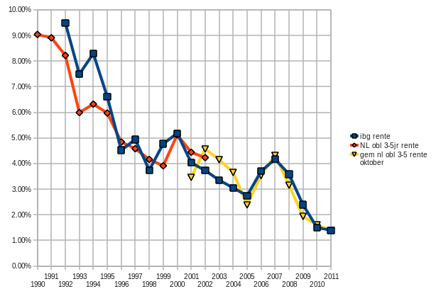

Deze vraag bleek uiteindelijk eenvoudig te beantwoorden, al heb ik de [hulp van Tofik Dibi en oud-minister Plasterk](https://web.archive.org/web/20130817055625/http://www.nieuwsbank.nl/inp/2009/06/19/R365.htm "Goede vragen van Tofik Dibi (en goede antwoorden van het ministerie van OCW onder Plasterk), archived") in moeten roepen. In de Wet studiefinanciering staat dit namelijk haarfijn uitgelegd. [Artikel 4.3](https://web.archive.org/web/20250118081636/https://mijnwetten.nl/wet-studiefinanciering-bes/artikel4.3 "Wet studiefinanciering, artikel 4.3. Vaststelling rentepercentage, archived") van deze wet vertelt ons dat het rentepercentage van een jaar gelijk is aan het gemiddeld effectief rendement over de maand oktober van dat jaar van Nederlandse staatsobligaties met een looptijd van 3 tot 5 jaar.

Met de hulp van [Statline](https://opendata.cbs.nl/ "Statline, CBS open data") van het CBS is deze informatie (of althans, iets dat daar bij in de buurt komt) eenvoudig op te vragen. Men zoeke onder “Aandelen obligaties; openbare emissie” naar onderwerp “Emissie rendement obligaties” en neme dan de gemiddelden van alle percentages in oktober van elk jaar. Dit is niet helemaal gelijk aan het [effectief rendement](https://nl.wikipedia.org/wiki/Staatsobligatie#Effectief_rendement "Effectief rendement op staatsobligaties, Wikipedia"), maar komt er aardig in de buurt. Voor de jaren 1992 t/m 2000 (voorgaande data loopt pas vanaf 2001) kun je bijvoorbeeld onder “Geld- en kapitaalmarkt, 1900-2002” zoeken op onderwerp Aandelen en obligaties -&gt; Obligaties -&gt; Rendementen staatsleningen -&gt; 3-5 jaar. Dit zijn gemiddelden van een heel jaar, terwijl we eigenlijk alleen die van oktober willen, maar bij gebrek aan beter moet dit maar volstaan. De [rentes op studieschuld tenslotte vinden we op de site van DUO](https://web.archive.org/web/20130104233632/http://www.duo.nl/particulieren/studieschuld/rentepercentages_leningen_na_1_1_1992.asp "DUO, Rentepercentages van leningen ontvangen na 1-1-1992, archived").

Deze twee obligatierentekoersen lijken dan inderdaad aardig met de rente op studieschuld te correleren, zelfs uitstekend in de laatste paar jaren (waarom daarvoor minder is me niet helemaal duidelijk, behalve natuurlijk voor de jaren waarvoor geen oktober metingen bij CBS te krijgen zijn). Zie grafiek en [voor alle data dit excel sheetje](/files/studieschuld-correlatie.xls "Excel sheet met data van studieschuld rentes en de correlerende obligatie rentes").
