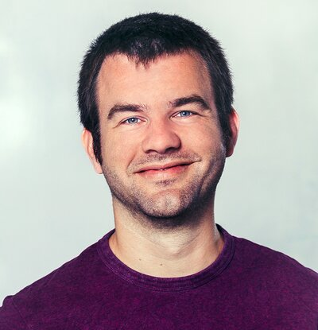

{: .about-photo}

🇺🇸

Hi, I’m Patrick Bos, **freelance data scientist, consultant** and **senior research software engineer (RSE)** with a background in **astrophysics**.

I have been working in research software engineering full-time since 2014. I spent 12 years at the Netherlands eScience Center (NLeSC), where I led research software quality efforts as Technology Lead, and I now work at the University of Groningen. As a freelancer with **Bos Data Science**, I take on projects that build or improve research software and apply data science methods.

Before becoming an RSE, I did a PhD in astrophysics and cosmology, on cosmic voids and dark energy. More recently, I have been working on explainable AI methods for research.

My [CV (PDF)](/files/CV_Patrick_Bos_20250324.pdf) has the full career details, and my [LinkedIn profile](https://www.linkedin.com/in/egpbos) is a shorter version of it.
Concrete projects, tools and small webapps are on my [Work](/work/) page, which also lists my [publications](/work/#publications). Curious about something? [Get in touch](mailto:egpbos@gmail.com).

🇳🇱

Hallo, ik ben Patrick Bos, **freelance data scientist, adviseur** en **senior research software engineer** met een achtergrond in de **astrofysica**.

Ik werk sinds 2014 full-time in research software engineering. Eerst 12 jaar bij het Netherlands eScience Center, waar ik als Technology Lead de softwarekwaliteit aanstuurde, en inmiddels bij de Rijksuniversiteit Groningen. Als freelancer bij **Bos Data Science** doe ik vergelijkbare projecten.

M’n curriculum vitae (in het Engels) staat als [PDF](/files/CV_Patrick_Bos_20250324.pdf) online; m’n [LinkedIn-profiel](https://www.linkedin.com/in/egpbos) is een kortere versie daarvan.
Concrete projecten, tools en webapps vind je op de [Work-pagina](/work/), waar ook m’n [publicaties](/work/#publications) staan.
Neem gerust contact met me op voor meer informatie.
