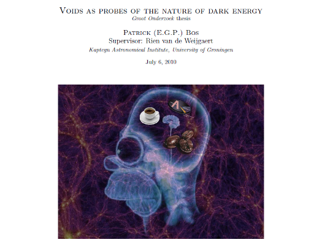
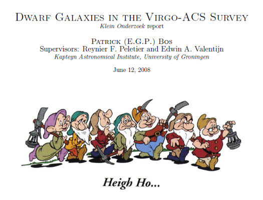
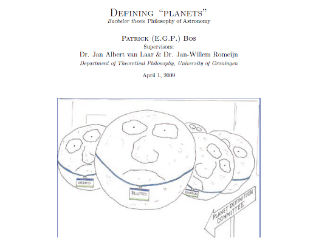

🇺🇸

Hi, I’m Patrick Bos, **freelance data scientist, consultant** and **senior research software engineer (RSE)** with a background in **astrophysics**.

I have been in research software engineering (RSEing) full-time since 2014, first for 12 years at the Netherlands eScience Center (NLeSC) in Amsterdam and now at the University of Groningen. As an RSE, I team up with researchers to apply and develop digital technology to answer research questions.

I currently work on two projects at the Kapteyn Astronomical Institute: the [PROTEUS](https://github.com/FormingWorlds/PROTEUS) exoplanet simulation framework and the ALMA radio telescope array [data reduction pipeline](https://almascience.nrao.edu/processing/science-pipeline).
In the past, I worked on *digital humanities* projects about media, politics, art and language. I’ve applied many techniques, including text mining, linked data, point cloud analysis, as well as machine learning and natural language processing. I also worked with *particle physicists*. They do calculations of models of the smallest particles. These models have to be compared to data from experiments. Because the models are highly complex and a lot of data comes from the experiments the calculations take a long time to complete. It was my task to speed this up. In my later years at NLeSC, I led the software quality efforts of the Center as Technology Lead. I also oversaw the technology plans and choices in a large number of projects. You can read more about my past projects at [my Research Software Directory page](https://research-software-directory.org/persons/cbd546a2-5bdf-423b-8a29-b2d53720792e/projects "my NLeSC projects").

As a *freelancer* with my company **Bos Data Science**, I take on similar projects, to build and apply tools and methods for advanced data analysis or to optimize existing numerical/scientific computing software. Please, do not hesitate to contact me if you want to know what I can do for you.

In my PhD years, I specialized in the *large scale structures of the universe* and *cosmology*. Specifically, I studied the interplay of the *cosmic web* – the intricate pattern of filaments and sheets that surround huge empty regions (voids), and which fills the entire universe like a foam – with the heaviest objects in the universe, *galaxy clusters*, that reside at the knots connecting filaments and sheets. I also worked on ways to shed more light on the nature of *dark energy* – one of the greatest mysteries in physics at the moment – e.g. by probing the shapes of voids. I, furthermore, built Bayesian models to bring together astronomical observations and physical models. Among other things, these allow us to predict where dark matter is hiding out.

In more recent years, I've gained an interest in the field of explainable AI (XAI), which with the boom of machine learning applications across all research domains has become more and more relevant. Together with former NLeSC colleagues, we developed DIANNA, an XAI method comparison tool built for researchers. We also developed our own method called [Distance Explainer](https://arxiv.org/abs/2505.15516), an evolution of RISE built for embedding models.

{: width="200"}

🇳🇱

Hallo, ik ben Patrick Bos, **freelance data scientist, adviseur** en **senior research software engineer** met een achtergrond in de **astrofysica**.

<!-- Ik werk aan het Netherlands eScience Center in Amsterdam. Daar ontwikkel ik samen met wetenschappers methoden om hun onderzoek een stapje verder te brengen. Dat doen we door de nieuwste technieken uit de dataverwerking en computertechnologie toe te passen.

Ik werk in *digital humanities* projecten over media, politiek, kunst en taal. Ik heb daarbij vele technieken gebruikt, zoals text mining, linked data, 3D puntenwolken, machine learning en natural language processing. Ik werk ook met *deeltjesfysici*. Zij rekenen aan modellen van de allerkleinste deeltjes. De modellen moeten worden vergeleken met de uitkomsten van experimenten. Omdat de modellen erg ingewikkeld zijn en er veel data uit de experimenten komt duren die berekeningen erg lang. Aan mij de taak dit sneller te maken. Op [mijn Netherlands eScience Center pagina](http://www.esciencecenter.nl/profile/patrick-bos "mijn NLeSC pagina") leest u meer over mijn projecten.

Als freelancer bij mijn bedrijf **Bos Data Science doe ik gelijksoortige projecten, waarin ik software en methodes ontwikkel en toepas voor geavanceerde data analyse of om bestaande numerieke/wetenschappelijke software te optimaliseren en versnellen. Aarzel niet om contact met me op te nemen als u wilt weten wat ik voor u kan doen.

Naast mijn werk ben ik wel eens bezig met de *grote schaal structuren van het heelal* en de *kosmologie.* Ik onderzoek op dit moment de interactie van het *kosmische web* – het patroon van filamenten en wanden die gigantische lege regio’s (*kosmische* *holtes*) omhullen, en dat het gehele universum opvult als een soort schuim – met de zwaarste objecten in het universum, *clusters van sterrenstelsels*, die zich op de knooppunten van filamenten en wanden bevinden. Daarnaast probeer ik enig licht te werpen op de aard van *donkere energie* – een van de grootste mysteries in de natuurkunde op dit moment – bijvoorbeeld door de vorm van kosmische holtes in het web te bepalen.

Om deze onderwerpen beter te begrijpen werk ik aan Bayesiaanse modellen om waarnemingen en fysische modellen bij elkaar te brengen. Hiermee kunnen we voorspellen waar zich bijvoorbeeld donkere materie bevindt. -->

# CV

🇺🇸

My curriculum vitae: [Download PDF CV](/files/CV_Patrick_Bos_20250324.pdf). Also, have a look at my [LinkedIn profile](http://www.linkedin.com/in/egpbos).

Please, contact me if you are interested in further details.

🇳🇱

M’n curriculum vitae (in het Engels): [Download PDF CV](/files/CV_Patrick_Bos_20250324.pdf). Neem ook eens een kijkje op m’n [LinkedIn profiel](http://www.linkedin.com/in/egpbos).

Neem gerust contact met me op voor meer informatie.

# Publications

🇺🇸

To browse a list of my publications, you could look me up on [arXiv](http://arxiv.org/find/astro-ph/1/au:+Bos_E/0/1/0/all/0/1 "My articles on arXiv"), [Google Scholar](http://scholar.google.nl/citations?user=3Le2IcUAAAAJ "My articles on Google Scholar") or [dblp](http://dblp.uni-trier.de/pers/hd/b/Bos:E=_G=_Patrick "My articles on dblp"), or do an author query on [ADS](http://adsabs.harvard.edu/cgi-bin/nph-abs_connect?return_req=no_params&author=Bos,%20E.%20G.%20Patrick&db_key=PRE&db_key=AST&start_year=2011&start_mon=10). Based on my study of dark energy and cosmic voids an [article in New Scientist](<http://www.newscientist.com/article/mg21628924.100-dark-energy-hints-hidden-in-cosmic-voids.html >) was written.

[My dissertation](http://hdl.handle.net/11370/0f7c3d17-9661-4b9f-a27c-dfac2990b844) can be downloaded from the RUG website; [for a good summary about my dissertation, see this interview](http://www.rug.nl/sciencelinx/nieuws/2016/11/20161129_bos). I put [the LaTeX template I used for my dissertation](https://github.com/egpbos/rug_phd_thesis_template) on GitHub.

Below you’ll find some of the stuff I’ve produced in my undergraduate years. Click on the images to find out more.

🇳🇱

Op [arXiv](http://arxiv.org/find/astro-ph/1/au:+Bos_E/0/1/0/all/0/1 "My articles on arXiv"), [Google Scholar](http://scholar.google.nl/citations?user=3Le2IcUAAAAJ "My articles on Google Scholar") of [dblp](http://dblp.uni-trier.de/pers/hd/b/Bos:E=_G=_Patrick "Mijn artikelen op dblp") kunt u m’n publicatielijsten vinden, of via een “*author query*” op [ADS](http://adsabs.harvard.edu/cgi-bin/nph-abs_connect?return_req=no_params&author=Bos,%20E.%20G.%20Patrick&db_key=PRE&db_key=AST&start_year=2011&start_mon=10 "Author query on ADS"). Naar aanleiding van m’n onderzoek naar donkere energie en holtes in het kosmische web is er ook een [artikeltje in New Scientist](<http://www.newscientist.com/article/mg21628924.100-dark-energy-hints-hidden-in-cosmic-voids.html >) geweest.

[Mijn proefschrift](http://hdl.handle.net/11370/0f7c3d17-9661-4b9f-a27c-dfac2990b844) is van de RUG website te downloaden; [lees dit interview voor een goede samenvatting van m’n proefschrift](http://www.rug.nl/sciencelinx/nieuws/2016/11/20161129_bos). [Het LaTeX template dat ik voor het proefschrift gebruikt heb](https://github.com/egpbos/rug_phd_thesis_template) staat op GitHub.

Hieronder daarnaast een selectie van stukjes die ik in m’n studietijd geproduceerd heb. Klik op de plaatjes om meer te lezen.

---

