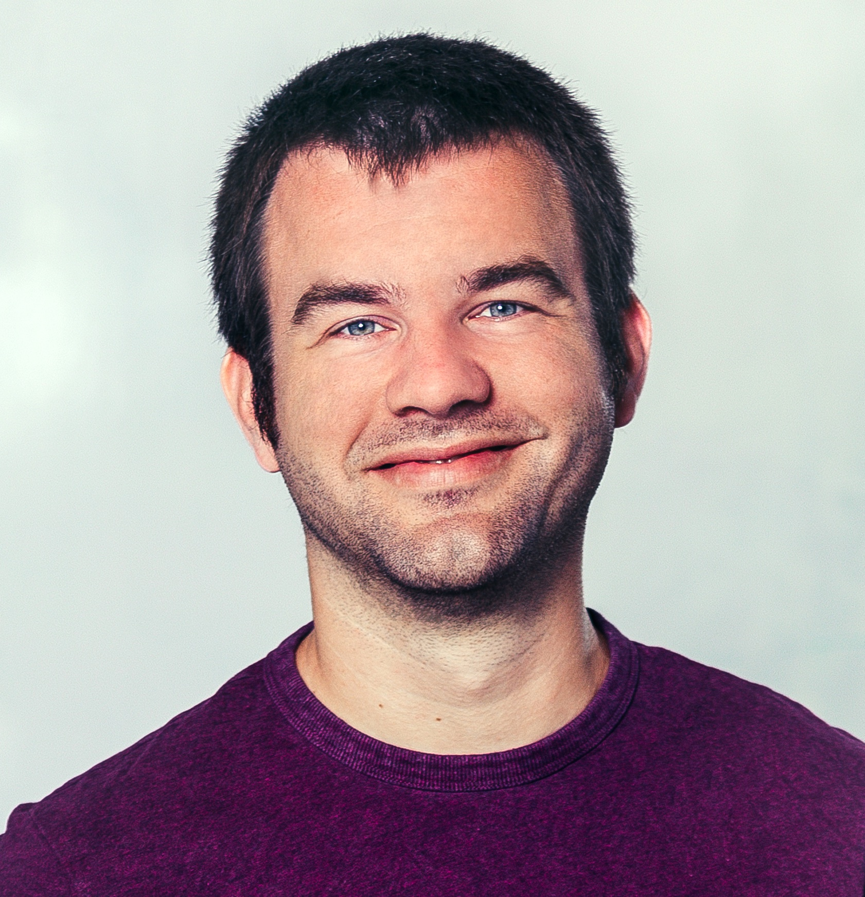

{: .identity-photo}

**Research software engineer** · freelance consultant & developer · PhD astrophysics

I help research groups and companies make scientific code faster, more reliable and easier to maintain, from exoplanet simulations to the ALMA pipeline.

[Email me](mailto:egpbos@gmail.com) · [CV (PDF)](/files/CV_Patrick_Bos_20250324.pdf) · [About](/about/) · [LinkedIn](https://www.linkedin.com/in/egpbos)

🇳🇱

**Onderzoekssoftware-ingenieur** · freelance adviseur & ontwikkelaar · PhD astrofysica

Ik help onderzoeksgroepen en bedrijven wetenschappelijke code sneller, betrouwbaarder en makkelijker te onderhouden te maken, van exoplanetsimulaties tot de ALMA-pipeline.

[E-mail mij](mailto:egpbos@gmail.com) · [CV (PDF)](/files/CV_Patrick_Bos_20250324.pdf) · [Over mij](/about/) · [LinkedIn](https://www.linkedin.com/in/egpbos)
