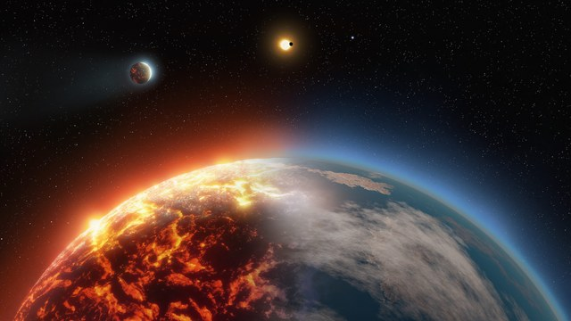
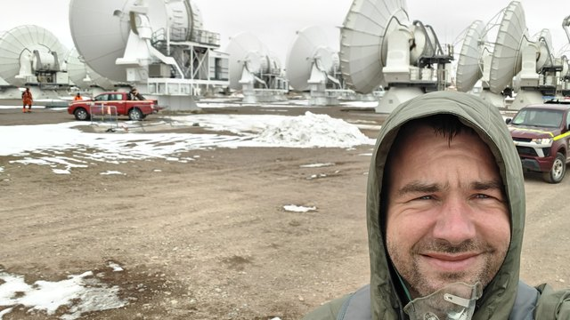
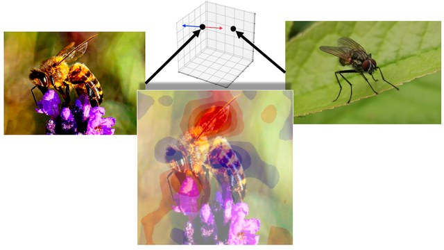
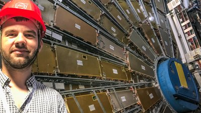
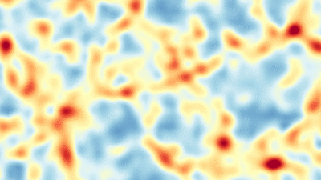

Selected projects and tools I have built or worked on. The [About](/about/) page covers my background and CV.

## Current projects

<section class="project-grid">
  

    
    

      <h3><a href="https://github.com/FormingWorlds/PROTEUS">PROTEUS</a></h3>
      
Simulates rocky exoplanets from magma-ocean worlds to solid surfaces. I work on framework engineering, benchmarking, HPC and software quality.

      
Illustration from the <a href="https://proteus-framework.org/">PROTEUS framework website</a>, reused under <a href="https://proteus-framework.org/license/">CC BY 4.0</a>.

    

  

  

    
    

      <h3><a href="https://almascience.nrao.edu/processing/science-pipeline">ALMA Pipeline</a></h3>
      
The ALMA data-reduction pipeline, focusing on performance, modernization and readiness for larger data volumes. I also do project management for the NOVA team.

      
Photo: me at the ALMA site.

    

  

  

    
    

      <h3><a href="https://dianna.readthedocs.io/en/latest/">Explainable AI</a></h3>
      
Opens black-box ML models through <a href="https://dianna.readthedocs.io/en/latest/">DIANNA</a> and <a href="https://arxiv.org/abs/2505.15516">Distance Explainer</a>.

      
Image: Distance Explainer README.

    

  

</section>

## Past projects

<section class="project-list">
  

    

      <h3><a href="https://research-software-directory.org/persons/cbd546a2-5bdf-423b-8a29-b2d53720792e/projects">Research software quality at NLeSC</a></h3>
      
As Technology Lead, I led software quality efforts and oversaw technical choices in many research projects.

    

  

  

    

      <h3>Digital humanities data analysis</h3>
      
Work on archeology, media, politics, art and language projects using text mining, linked data, point clouds, machine learning and NLP.

    

  

  

    
    

      <h3><a href="https://root.cern">Particle physics performance work</a></h3>
      
Helped speed up comparisons between complex theoretical models and experimental data for CERN/LHC experiments in RooFit/ROOT.

      
Photo: me in the LHC ATLAS detector cave.

    

  

  

    
    

      <h3><a href="https://github.com/egpbos/barcode">BARCODE</a></h3>
      
Bayesian reconstruction of the cosmic density field, with a self-consistent analytical model for redshift space distortions.

      
Animation from the BARCODE paper (Bos et al. 2019): the Eulerian field alternates with the same field in redshift space. Click for the full field.

    

  

</section>

## Vibearium

Small webapps I have built recently, mostly with a lot of AI assistance, and deployed on GitHub Pages.

- **[Allage](https://egpbos.nl/allage/)** adds up the ages of everyone in a group and finds group age anniversaries. [Source](https://github.com/egpbos/allage)
- **[Timezone compare](https://egpbos.nl/timezone-compare/)** helps plan meetings across time zones. [Source](https://github.com/egpbos/timezone-compare)
- **[RSE self-test](https://egpbos.nl/rseselftest/)** asks whether you are already a research software engineer and suggests what to do next. [Source](https://github.com/egpbos/rseselftest)
- **[Coalitiestatengeneraal](https://egpbos.nl/coalitiestatengeneraal/)** checks possible coalitions for the Dutch parliament, including both chambers. [Source](https://github.com/egpbos/coalitiestatengeneraal)

## Publications

My research papers are easiest to browse on [arXiv](https://arxiv.org/search/?searchtype=author&query=Bos%2C%20E%20G%20P), [Google Scholar](https://scholar.google.com/citations?user=3Le2IcUAAAAJ), [dblp](https://dblp.org/pers/hd/b/Bos:E=_G=_Patrick) or [ADS](https://ui.adsabs.harvard.edu/search/q=author%3A%22Bos%2C%20E%20G%20P%22). My study of dark energy and cosmic voids also led to a [New Scientist article](https://web.archive.org/web/20221206144504/https://www.newscientist.com/article/mg21628924-100-dark-energy-hints-hidden-in-cosmic-voids/).

My [dissertation](https://research.rug.nl/en/publications/clusters-voids-and-reconstructions-of-the-cosmic-web/), on cosmic voids as a probe of dark energy, is available from the University of Groningen. [This interview](https://web.archive.org/web/20240302043230/https://www.rug.nl/sciencelinx/nieuws/2016/11/20161129_bos) gives a good summary of it, and the [LaTeX template I used for the thesis](https://github.com/egpbos/rug_phd_thesis_template) is on GitHub.

For the full list of projects and roles, see my [CV](/files/CV_Patrick_Bos_20250324.pdf).
